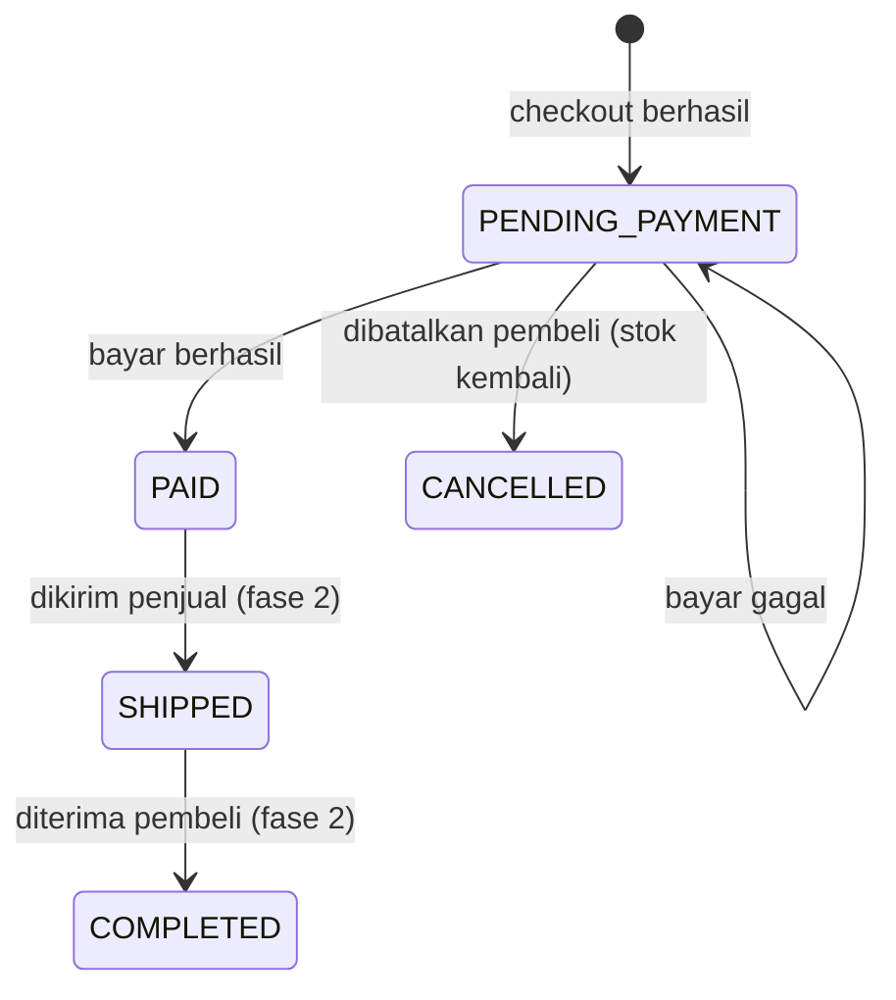

# PRD — Marketplace Grocery (Portfolio QA Automation)

> Status: draft v1 · 4 November 2026 · Nama aplikasi belum ditentukan (sementara: `marketplace`)

## 1. Ringkasan dan tujuan

Aplikasi marketplace web untuk kebutuhan dapur/grocery (sayur, buah, sembako, minuman, frozen food) yang dibangun sebagai sistem yang diuji untuk portfolio QA Automation. Fase 1 menargetkan alur pembeli lengkap: katalog, keranjang, checkout, pembayaran simulasi, dan riwayat pesanan.

Tiga tujuan, berurutan menurut prioritas:

1. **Portfolio:** memperlihatkan kemampuan menguji lintas layer (unit, API, E2E) yang berjalan otomatis di CI.
2. **Produk:** alur pembeli end-to-end yang terasa seperti marketplace pada umumnya.
3. **Belajar:** membangun full stack JavaScript dengan MySQL.

Kalau tujuan 2 atau 3 mulai menghambat tujuan 1 (misalnya fitur terus bertambah sebelum test-nya ditulis), tujuan 1 yang menang.

| Metrik keberhasilan | Target fase 1 |
| --- | --- |
| Alur pembeli di UI | Katalog → keranjang → checkout → bayar simulasi berjalan tanpa error |
| API test | Setiap endpoint fase 1: 1 happy path + minimal 2 kasus negatif |
| E2E test | Minimal 5 alur utama pembeli |
| CI | Semua test berjalan otomatis di setiap push dan hijau |
| Stabilitas | 0 test flaky dalam 10 run CI berturut-turut |
| Dokumentasi | README + traceability matrix (user story → acceptance criteria → test) |

Angka target di atas adalah usulan awal dan boleh diubah.

## 2. Ruang lingkup

Fase 1 hanya mencakup sisi pembeli. Data toko dan produk diisi lewat seed, belum ada dashboard penjual.

| Fase | Fitur |
| --- | --- |
| 1 (MVP) | Register/login pembeli; beranda dengan kategori, pencarian, filter harga, sorting, pagination; detail produk; keranjang; checkout dengan alamat dan ongkir flat; pembayaran simulasi (berhasil/gagal); riwayat dan detail pesanan; pembatalan pesanan yang belum dibayar |
| 2 | Penjual (multi-toko): kelola produk, proses pesanan; status lanjutan Dikirim → Selesai |
| 3 (opsional) | Review dan rating, voucher diskon, panel admin |

**Di luar scope (semua fase):** payment gateway asli, API ekspedisi asli, chat, notifikasi email, upload gambar ke cloud (gambar cukup berupa URL), wishlist, recently viewed, blog, Docker (dipelajari setelah fase 1 selesai).

## 3. Persona dan role

Fase 1 punya dua role yang aktif: Tamu dan Pembeli. Perbedaan hak akses antar role adalah sumber utama skenario test otorisasi.

| Role | Bisa | Tidak bisa | Fase |
| --- | --- | --- | --- |
| Tamu | Melihat katalog, mencari, filter, melihat detail produk | Menambah ke keranjang, checkout, melihat pesanan (diarahkan ke login) | 1 |
| Pembeli | Semua yang bisa dilakukan Tamu + keranjang, checkout, bayar, lihat dan batalkan pesanan miliknya | Melihat keranjang atau pesanan milik pembeli lain | 1 |
| Penjual | Mengelola produk dan memproses pesanan tokonya sendiri | Mengubah produk atau pesanan toko lain | 2 |
| Admin | Mengelola kategori, user, dan toko | — | 3 |

## 4. User stories dan acceptance criteria (fase 1)

Fase 1 terdiri dari 11 user story. Setiap acceptance criteria (AC) diberi ID supaya bisa dirujuk langsung dari nama test, misalnya `[AC-08.3]`.

### Katalog

**US-01 Melihat katalog.** Sebagai tamu atau pembeli, saya ingin melihat daftar produk supaya bisa memilih barang.

- AC-01.1: Beranda menampilkan produk terbaru, 12 per halaman, beserta nama, harga (format Rp), nama toko, dan gambar.
- AC-01.2: Produk dengan stok 0 tetap tampil dengan label "Habis".
- AC-01.3: Pagination menampilkan halaman aktif dan total halaman; halaman di luar jangkauan menampilkan daftar kosong, bukan error.

**US-02 Mencari dan memfilter produk.** Sebagai pengguna, saya ingin mencari dan memfilter supaya cepat menemukan barang.

- AC-02.1: Pencarian berdasarkan nama produk, tidak membedakan huruf besar/kecil.
- AC-02.2: Filter kategori dan rentang harga (min, max) bisa dikombinasikan dengan pencarian.
- AC-02.3: Sorting: terbaru, harga terendah, harga tertinggi.
- AC-02.4: Harga min lebih besar dari max menampilkan pesan validasi; API mengembalikan 400.
- AC-02.5: Tidak ada hasil → tampil pesan "Produk tidak ditemukan".
- AC-02.6: Filter dan pencarian tersimpan di URL, sehingga halaman bisa di-refresh atau dibagikan dengan hasil yang sama.

**US-03 Melihat detail produk.** Sebagai pengguna, saya ingin melihat detail produk sebelum membeli.

- AC-03.1: Menampilkan nama, harga, stok, deskripsi, kategori, dan nama toko.
- AC-03.2: ID produk yang tidak ada → halaman "Produk tidak ditemukan"; API mengembalikan 404.
- AC-03.3: Stok 0 → tombol "Tambah ke keranjang" nonaktif.

### Akun

**US-04 Register.** Sebagai tamu, saya ingin membuat akun supaya bisa berbelanja.

- AC-04.1: Field wajib: nama, email, password, konfirmasi password.
- AC-04.2: Email harus valid dan belum terdaftar (pengecekan tidak membedakan huruf besar/kecil).
- AC-04.3: Password minimal 8 karakter, mengandung huruf dan angka; konfirmasi harus sama.
- AC-04.4: Berhasil → langsung login dan diarahkan ke beranda.

**US-05 Login dan logout.** Sebagai pembeli, saya ingin masuk dan keluar dari akun saya.

- AC-05.1: Kredensial benar → login berhasil, nama pembeli tampil di header.
- AC-05.2: Email tidak terdaftar atau password salah → pesan yang sama: "Email atau password salah".
- AC-05.3: Logout menghapus sesi; halaman keranjang dan pesanan tidak bisa dibuka lagi tanpa login.
- AC-05.4: Tamu yang membuka halaman khusus pembeli diarahkan ke login, lalu kembali ke halaman semula setelah login.

### Keranjang

**US-06 Menambah ke keranjang.** Sebagai pembeli, saya ingin menambah produk ke keranjang.

- AC-06.1: Jumlah minimal 1 dan tidak boleh melebihi stok.
- AC-06.2: Menambah produk yang sudah ada di keranjang menggabungkan jumlahnya, tetap dibatasi stok.
- AC-06.3: Ikon keranjang di header menampilkan jumlah item terbaru.
- AC-06.4: Tamu yang menekan "Tambah ke keranjang" diarahkan ke login.

**US-07 Mengelola keranjang.** Sebagai pembeli, saya ingin mengubah jumlah dan menghapus item.

- AC-07.1: Mengubah jumlah langsung memperbarui subtotal dan total.
- AC-07.2: Jumlah 0 atau negatif ditolak; untuk menghapus gunakan tombol hapus.
- AC-07.3: Jika stok produk turun di bawah jumlah di keranjang, item diberi peringatan dan checkout diblokir sampai jumlah disesuaikan.
- AC-07.4: Keranjang kosong → pesan kosong dan tombol checkout nonaktif.

### Checkout dan pesanan

**US-08 Checkout.** Sebagai pembeli, saya ingin membuat pesanan dari isi keranjang.

- AC-08.1: Alamat pengiriman wajib diisi (10–255 karakter).
- AC-08.2: Ringkasan menampilkan subtotal, ongkir flat, dan total.
- AC-08.3: Total dihitung ulang di server; harga yang dikirim dari browser diabaikan.
- AC-08.4: Jika satu item stoknya tidak cukup, seluruh checkout gagal dan tidak ada stok yang berkurang.
- AC-08.5: Berhasil → pesanan berstatus Menunggu Pembayaran, stok berkurang, keranjang kosong, diarahkan ke halaman pembayaran.

**US-09 Membayar (simulasi).** Sebagai pembeli, saya ingin membayar pesanan.

- AC-09.1: Halaman pembayaran punya dua tombol: "Bayar (berhasil)" dan "Simulasikan gagal".
- AC-09.2: Berhasil → status menjadi Dibayar.
- AC-09.3: Gagal → status tetap Menunggu Pembayaran dan pembeli bisa mencoba lagi.
- AC-09.4: Pesanan yang sudah Dibayar atau Dibatalkan tidak bisa dibayar lagi; API mengembalikan 409.

**US-10 Melihat riwayat dan detail pesanan.** Sebagai pembeli, saya ingin melihat pesanan saya.

- AC-10.1: Daftar pesanan diurutkan dari yang terbaru, menampilkan tanggal, total, dan status.
- AC-10.2: Detail menampilkan item dengan harga saat beli, alamat, ongkir, total, dan status.
- AC-10.3: Membuka pesanan milik pembeli lain → "Pesanan tidak ditemukan"; API mengembalikan 404.

**US-11 Membatalkan pesanan.** Sebagai pembeli, saya ingin membatalkan pesanan yang belum dibayar.

- AC-11.1: Tombol batal hanya muncul untuk pesanan Menunggu Pembayaran.
- AC-11.2: Batal → status Dibatalkan dan stok setiap item dikembalikan.
- AC-11.3: Membatalkan pesanan yang sudah Dibayar ditolak; API mengembalikan 409.

## 5. Aturan bisnis

Aturan bisnis berlaku di server, bukan hanya di UI. Setiap aturan diberi ID BR-xx dan minimal satu API test harus membuktikan aturan itu ditegakkan meski UI dilewati.

| ID | Area | Aturan |
| --- | --- | --- |
| BR-01 | Katalog | Produk stok 0 tetap tampil, berlabel "Habis", dan tidak bisa dibeli |
| BR-02 | Katalog | Pagination default 12 item, maksimal 48 per halaman; `limit` di atas 48 dibatasi menjadi 48 |
| BR-03 | Katalog | Filter harga: min dan max ≥ 0, min ≤ max; jika tidak, 400 |
| BR-04 | Akun | Email unik tanpa membedakan huruf besar/kecil |
| BR-05 | Akun | Password minimal 8 karakter, mengandung huruf dan angka, disimpan sebagai hash bcrypt |
| BR-06 | Akun | Login gagal selalu memberi pesan yang sama, tanpa membocorkan apakah email terdaftar |
| BR-07 | Akun | Token login berlaku 24 jam; token kedaluwarsa atau palsu → 401 |
| BR-08 | Keranjang | Jumlah per item: minimal 1, maksimal stok saat ini |
| BR-09 | Keranjang | Produk yang sama digabung menjadi satu baris, jumlahnya dijumlahkan |
| BR-10 | Checkout | Total = Σ(harga × jumlah) + ongkir flat Rp10.000, dihitung di server |
| BR-11 | Checkout | Checkout bersifat atomic (satu transaksi database): satu item gagal → semua dibatalkan |
| BR-12 | Checkout | Stok dikurangi saat pesanan dibuat (Menunggu Pembayaran), bukan saat dibayar |
| BR-13 | Checkout | Harga saat beli disimpan per item; perubahan harga produk tidak mengubah pesanan lama |
| BR-14 | Checkout | Keranjang dikosongkan hanya jika checkout berhasil |
| BR-15 | Pesanan | Transisi status hanya yang diizinkan (lihat diagram di bawah); transisi lain → 409 |
| BR-16 | Pesanan | Pembatalan mengembalikan stok setiap item |
| BR-17 | Pesanan | Pembeli hanya bisa mengakses keranjang dan pesanannya sendiri; milik orang lain → 404 (bukan 403, supaya keberadaan data tidak bocor) |

BR-12 adalah keputusan desain yang bisa diperdebatkan: stok "terkunci" oleh pesanan yang tidak pernah dibayar. Di fase 1 ini diterima karena pembeli bisa membatalkan; auto-cancel masuk daftar pertanyaan terbuka.

### Alur status pesanan



Setiap panah adalah transisi yang harus diuji berhasil, dan setiap pasangan status tanpa panah adalah transisi yang harus diuji ditolak (409).

## 6. Kebutuhan non-fungsional

Kebutuhan terpenting untuk project ini adalah testability: aplikasi sengaja dirancang supaya mudah, cepat, dan stabil untuk diuji.

| Area | Kebutuhan |
| --- | --- |
| Testability | Endpoint `POST /api/test/reset` yang mengembalikan database ke data seed; hanya aktif saat `NODE_ENV=test` (di mode lain → 404) |
| Testability | Data seed deterministik: ID, nama, harga, dan stok selalu sama di setiap reset |
| Testability | Database test terpisah (`marketplace_test`) dari database development |
| Testability | Markup aksesibel (role, label) supaya locator `getByRole`/`getByLabel` bisa dipakai; `data-testid` hanya untuk elemen tanpa role atau label yang jelas |
| Keamanan | Password di-hash dengan bcrypt; query memakai parameter (tidak menyambung string SQL); validasi input di server |
| Keamanan | Token JWT dikirim lewat header `Authorization: Bearer`; secret disimpan di `.env`, tidak di-commit |
| Konsistensi API | Semua error memakai satu format JSON yang sama dan kode HTTP yang tepat |
| UI | Responsif dari lebar 360 px; setiap halaman data punya state loading, kosong, dan error |
| UI | Label pada setiap field form dan pesan validasi di dekat field-nya |
| Logging | Setiap request dicatat (method, path, status, durasi) di console backend |

Target performa formal belum ditetapkan di fase 1 karena data seed kecil dan berjalan lokal; angka yang diukur di laptop tidak mewakili kondisi nyata.

## 7. Model data

Fase 1 memakai 7 tabel MySQL. Tabel `stores` sudah dibuat sekarang (diisi seed) supaya fase 2 tidak perlu mengubah struktur tabel produk dan pesanan.

| Tabel | Kolom | Catatan |
| --- | --- | --- |
| `users` | id, name, email (unik), password_hash, role, created_at | role fase 1: `buyer`; `seller` dan `admin` disiapkan |
| `stores` | id, user_id, name, created_at | Fase 1: 3 toko dari seed |
| `categories` | id, name, slug (unik) | Fase 1: 5 kategori dari seed |
| `products` | id, store_id, category_id, name, description, price, stock, image_url, created_at, updated_at | price dalam rupiah (INT, tanpa desimal); stock ≥ 0 |
| `cart_items` | id, user_id, product_id, quantity, created_at | Unik per (user_id, product_id) → mendukung BR-09 |
| `orders` | id, user_id, status, subtotal, shipping_cost, total, shipping_address, created_at, updated_at | status: `PENDING_PAYMENT`, `PAID`, `CANCELLED` (fase 2: `SHIPPED`, `COMPLETED`) |
| `order_items` | id, order_id, product_id, product_name, price_at_purchase, quantity | Nama dan harga disalin saat checkout → BR-13 |

**Data seed:** 5 kategori grocery (misalnya Sayur & Buah, Sembako, Minuman, Frozen Food, Bumbu Dapur), 3 toko, sekitar 50 produk dengan nama dan harga realistis (termasuk beberapa dengan stok 0 dan stok 1 untuk kasus batas), dan 2 akun pembeli test dengan password yang diketahui.

Harga disimpan sebagai bilangan bulat rupiah supaya tidak ada masalah pembulatan desimal.

## 8. Endpoint API (fase 1)

Fase 1 punya 17 endpoint, semuanya di bawah prefix `/api`. Kolom Auth menunjukkan apakah request wajib membawa token.

| Method | Path | Auth | Fungsi | Story |
| --- | --- | --- | --- | --- |
| GET | `/api/categories` | Tidak | Daftar kategori | US-02 |
| GET | `/api/products` | Tidak | Daftar produk; query: `q`, `category`, `minPrice`, `maxPrice`, `sort`, `page`, `limit` | US-01, US-02 |
| GET | `/api/products/:id` | Tidak | Detail produk | US-03 |
| POST | `/api/auth/register` | Tidak | Buat akun, mengembalikan token | US-04 |
| POST | `/api/auth/login` | Tidak | Login, mengembalikan token | US-05 |
| GET | `/api/auth/me` | Ya | Data user yang sedang login | US-05 |
| GET | `/api/cart` | Ya | Isi keranjang + subtotal | US-07 |
| POST | `/api/cart/items` | Ya | Tambah produk (`productId`, `quantity`) | US-06 |
| PATCH | `/api/cart/items/:id` | Ya | Ubah jumlah | US-07 |
| DELETE | `/api/cart/items/:id` | Ya | Hapus item | US-07 |
| POST | `/api/orders` | Ya | Checkout dari keranjang (`shippingAddress`) | US-08 |
| GET | `/api/orders` | Ya | Riwayat pesanan milik user | US-10 |
| GET | `/api/orders/:id` | Ya | Detail pesanan | US-10 |
| POST | `/api/orders/:id/pay` | Ya | Pembayaran simulasi (`result`: `success` atau `failed`) | US-09 |
| POST | `/api/orders/:id/cancel` | Ya | Batalkan pesanan | US-11 |
| GET | `/api/health` | Tidak | Cek server dan koneksi database hidup | — |
| POST | `/api/test/reset` | Tidak | Reset database ke seed (hanya `NODE_ENV=test`) | — |

Perilaku katalog yang perlu dicatat:

- `GET /api/products?category=<slug>` dengan slug yang tidak dikenal mengembalikan 200 dengan daftar kosong (kategori diperlakukan sebagai filter, bukan resource).
- `GET /api/products/:id` dengan ID bukan angka (misalnya `abc`) mengembalikan 404, sama seperti ID yang tidak ada.
- Path yang tidak dikenal (misalnya `GET /`) mengembalikan 404 dengan format error di bawah.

Semua error memakai format yang sama:

```json
{
  "error": {
    "code": "INSUFFICIENT_STOCK",
    "message": "Stok produk tidak mencukupi",
    "details": [{ "productId": 12, "available": 1, "requested": 3 }]
  }
}
```

| Kode HTTP | Dipakai saat |
| --- | --- |
| 400 | Input tidak valid (validasi gagal) |
| 401 | Tidak ada token, token salah, atau kedaluwarsa |
| 404 | Data tidak ada, atau milik user lain (BR-17) |
| 409 | Konflik dengan kondisi data: stok tidak cukup, email sudah terdaftar, transisi status tidak diizinkan |
| 500 | Error tak terduga di server (tidak boleh muncul di test) |
| 503 | Database tidak dapat dihubungi (`GET /api/health`, kode `DB_UNAVAILABLE`); endpoint lain tetap 500 |

## 9. Halaman UI

Fase 1 punya 9 halaman. Header di setiap halaman berisi logo, kolom pencarian (dengan dropdown kategori), ikon akun, ikon keranjang dengan jumlah item, dan tombol login atau nama pembeli.

| Halaman | Route | Isi utama | Login |
| --- | --- | --- | --- |
| Beranda / katalog | `/` | Banner statis, tile kategori, grid produk, filter kategori dan harga, sorting, pagination | Tidak |
| Detail produk | `/products/:id` | Info produk, pemilih jumlah, tombol tambah ke keranjang | Tidak |
| Register | `/register` | Form nama, email, password, konfirmasi | Tidak |
| Login | `/login` | Form email dan password | Tidak |
| Keranjang | `/cart` | Daftar item, ubah jumlah, hapus, subtotal, tombol checkout | Ya |
| Checkout | `/checkout` | Alamat pengiriman, ringkasan biaya, tombol buat pesanan | Ya |
| Pembayaran | `/orders/:id/pay` | Total tagihan, tombol "Bayar (berhasil)" dan "Simulasikan gagal" | Ya |
| Riwayat pesanan | `/orders` | Daftar pesanan dengan status | Ya |
| Detail pesanan | `/orders/:id` | Item, alamat, rincian biaya, status, tombol batal | Ya |

## 10. Panduan desain UI

Desain harus rapi, konsisten, dan punya karakter sendiri, tanpa berubah menjadi proyek desain yang besar. Yang dinilai recruiter QA adalah test-nya.

### Arah visual (dari referensi template grocery)

Ambil polanya, bukan tampilannya. Logo, ilustrasi, nama, dan susunan identik dari template referensi tidak ditiru.

| Pola referensi | Versi project ini |
| --- | --- |
| Header: logo, search dengan dropdown kategori, ikon akun, keranjang dengan jumlah item + total | Diambil hampir utuh |
| Tombol "Shop by Category" di baris navigasi kedua | Tombol "Semua Kategori" + 4–5 kategori utama |
| Hero: banner besar + banner samping | 2 banner **statis** (tanpa autoplay), link ke kategori atau hasil filter |
| Kategori sebagai tile dengan ikon garis dua warna | Diambil; tile = link ke filter kategori |
| "Featured Brands" | Diganti "Toko Pilihan" (dari tabel `stores`) (ditunda ke fase berikutnya) |
| Ruang putih lega, aksen kuning-amber hangat, teks abu kebiruan gelap | Diambil sebagai arah, dengan kode warna sendiri |
| Menu Demos/Blog/Pages, nomor support, wishlist, recently viewed | Tidak dibuat |

Referensi hanya menutupi beranda versi desktop. Halaman lain dan tampilan mobile (360 px) didesain sendiri dengan gaya yang sama.

### Keputusan desain

| Elemen | Keputusan |
| --- | --- |
| Library | Tailwind CSS + shadcn/ui, dengan tema yang diatur sendiri (warna, radius, font), bukan tampilan bawaan |
| Warna | 4–6 warna: dasar putih/abu sangat muda, satu aksen kuning-amber, teks abu kebiruan gelap, plus warna status (hijau berhasil, kuning menunggu, merah gagal/batal) |
| Font | Satu atau dua font yang dipilih sengaja dan dicoba dengan konten asli, bukan Inter hanya karena default |
| Radius | Kecil |
| Ikon | Satu set konsisten (misalnya Lucide) |
| Layout | Mobile-first, mulai dari lebar 360 px |
| Komponen | Button, Input, Select, ProductCard, Badge (status, "Habis"), Pagination, Toast, dialog konfirmasi, empty state, skeleton loading |

### Hindari tampilan generik

- Kartu hanya untuk produk; bagian lain cukup dipisah spasi dan garis.
- Tanpa gradient dekoratif, tanpa label huruf kapital kecil di atas setiap judul, tanpa emoji sebagai ikon.
- Animasi hanya sebagai respons aksi pengguna (tambah ke keranjang, buka dialog). Tidak ada fade/slide di setiap section. Ini juga mengurangi risiko test flaky.
- Tidak ada carousel autoplay.
- Copy pendek dan spesifik. Nama aksi konsisten: tombol "Tambah ke keranjang" → notifikasi "Ditambahkan ke keranjang". Pesan error menjelaskan apa yang salah dan cara memperbaikinya.
- Foto produk dengan latar dan pencahayaan seragam.

### Desain yang mendukung testing

- State lengkap di setiap halaman: loading, kosong, error, sukses.
- Pesan validasi di dekat field, bukan hanya toast yang cepat hilang.
- Tombol nonaktif yang jelas (stok habis, keranjang kosong).
- Dialog konfirmasi untuk aksi yang tidak bisa dibatalkan (batalkan pesanan).

## 11. Strategi pengujian

Sebagian besar aturan bisnis dibuktikan lewat API test yang cepat dan stabil; E2E di browser hanya untuk alur utama pengguna.

| Layer | Tool | Cakupan | Perkiraan porsi |
| --- | --- | --- | --- |
| Unit | Vitest | Fungsi murni: hitung total, validasi password, transisi status | Sedikit, hanya logika inti |
| API | Playwright (`request`) | Semua endpoint, semua BR, semua kode error | Paling banyak |
| E2E web | Playwright (browser) | 5–8 alur utama + beberapa kasus negatif yang terlihat di UI | Sedikit, tapi mewakili alur nyata |

**Teknik desain test** yang dipakai dan ditunjukkan di dokumentasi:

- **Equivalence partitioning + boundary value:** jumlah keranjang (0, 1, stok, stok+1), panjang password (7, 8), panjang alamat (9, 10, 255, 256), harga filter.
- **State transition:** setiap pasangan status pesanan, termasuk transisi yang harus ditolak (BR-15).
- **Decision table:** checkout dengan kombinasi login/tidak, keranjang kosong/isi, stok cukup/kurang, alamat valid/tidak.
- **Authorization matrix:** setiap endpoint × (tanpa token, token pembeli A, token pembeli B).

**Data test:** setiap file test memanggil `POST /api/test/reset` sebelum mulai. E2E menyiapkan data lewat API (misalnya isi keranjang), bukan lewat klik di UI, supaya cepat dan tidak rapuh.

**Traceability:** nama test diawali ID yang dibuktikannya, misalnya `[AC-08.4][BR-11] checkout gagal seluruhnya jika satu item stoknya kurang`. Dari situ dibuat traceability matrix di `docs/` yang menunjukkan setiap AC sudah punya test.

**Struktur folder test:**

```
tests/
├── api/        ← per resource: products, auth, cart, orders
├── e2e/        ← per alur: browse, auth, cart, checkout, orders
├── fixtures/   ← login helper, reset helper, data builder
└── playwright.config.js
```

## 12. Tech stack dan environment

Semua bagian memakai JavaScript, dan database berjalan langsung di Mac tanpa Docker.

| Bagian | Pilihan |
| --- | --- |
| Runtime | Node.js versi LTS |
| Database | MySQL 8.4 via Homebrew (`mysql@8.4`) |
| Akses database | `mysql2` + file SQL (`schema.sql`, `seed.sql`) |
| Backend | Express, `bcrypt`, `jsonwebtoken`, `zod` (validasi input) |
| Frontend | React + Vite, React Router, Tailwind CSS, shadcn/ui (beserta dependensinya: `class-variance-authority`, `clsx`, `tailwind-merge`, `lucide-react`, `radix-ui`, `tw-animate-css`), font `@fontsource-variable/plus-jakarta-sans` |
| Test | Playwright (API + E2E), Vitest (unit) |
| CI | GitHub Actions dengan service MySQL 8.4 |
| Alat bantu | VS Code, Git, DBeaver (melihat isi database) |

| Environment | Database | Dipakai untuk |
| --- | --- | --- |
| Development (lokal) | `marketplace_dev` | Membangun dan mencoba fitur |
| Test (lokal dan CI) | `marketplace_test` | Menjalankan test, di-reset terus |
| Demo online | Belum ditentukan | Opsional, setelah fase 1 (lihat pertanyaan terbuka) |

**Struktur repo:**

```
marketplace/
├── backend/    ← Express API, schema.sql, seed.sql
├── frontend/   ← React + Vite
├── tests/      ← Playwright
├── docs/       ← PRD ini, test case, traceability matrix
└── .github/workflows/
```

## 13. Roadmap

Fase 1 dibagi menjadi 7 slice berurutan, ditambah fase Full Testing antara slice 5 dan slice 6. Di setiap slice urutannya sama: tabel → API → API test → UI → E2E test. Slice berikutnya dimulai hanya setelah Definition of Done slice sebelumnya terpenuhi.

| Slice | Isi | Story |
| --- | --- | --- |
| 0. Persiapan dan desain | Install tools, buat repo, `schema.sql` + `seed.sql`, PRD final (maksimal 3 hari) | — |
| 1. Katalog + CI | Katalog, pencarian, filter, detail; CI GitHub Actions mulai di sini | US-01 – US-03 |
| 2. Akun | Register, login, JWT, halaman khusus pembeli | US-04 – US-05 |
| 3. Keranjang | Tambah, ubah, hapus item, validasi stok | US-06 – US-07 |
| 4. Checkout dan pembayaran | Checkout atomic, stok berkurang, pembayaran simulasi | US-08 – US-09 |
| 5. Riwayat dan pembatalan | Riwayat, detail pesanan, pembatalan + stok kembali | US-10 – US-11 |
| Full Testing | Pengujian lintas slice setelah semua fitur selesai (rincian di bawah) | US-01 – US-11 |
| 6. Dokumentasi dan rilis portfolio | README, report publik, traceability matrix final dipublikasikan → repo siap dibagikan | — |

CI dipasang sejak slice 1, bukan di akhir, supaya setiap slice berikutnya langsung teruji otomatis. Durasi per slice sengaja tidak ditulis karena tergantung waktu luang; patokannya, slice 1 yang belum selesai dalam 2–3 minggu berarti scope-nya terlalu besar.

**Fase Full Testing (setelah slice 5, sebelum slice 6):**

Slice 6 dimulai hanya setelah semua poin ini terpenuhi.

- [ ] E2E perjalanan lengkap lintas slice: browse → register/login → keranjang → checkout → bayar → riwayat → batalkan
- [ ] Regression: semua test slice 1–5 dijalankan ulang, semuanya hijau
- [ ] Authorization matrix semua endpoint (lihat bagian 11)
- [ ] State transition pesanan, termasuk transisi yang harus ditolak (lihat bagian 11)
- [ ] Decision table checkout (lihat bagian 11)
- [ ] Stabilitas CI: 0 test flaky dalam 10 run berturut-turut (bagian 1)
- [ ] Exploratory testing: sesi terdokumentasi, temuan dicatat sebagai bug atau ditutup
- [ ] Tampilan di lebar 360 px dan navigasi keyboard di semua halaman (bagian 6)
- [ ] Traceability matrix lengkap: setiap AC dan BR sudah terhubung ke test

**Definition of done (berlaku untuk setiap slice):**

- [ ] Setiap AC di slice ini punya API test, semuanya hijau
- [ ] Alur utama slice punya E2E test + minimal 2 kasus negatif
- [ ] Semua test hijau di CI
- [ ] Test case dan traceability matrix di `docs/` diperbarui
- [ ] Tidak ada bug terbuka yang memblokir alur utama

## 14. Risiko, asumsi, dan pertanyaan terbuka

Risiko terbesar adalah scope creep: aplikasi terus bertambah fitur sementara test dan CI tidak pernah selesai.

| Risiko | Dampak | Mitigasi |
| --- | --- | --- |
| Scope creep | Portfolio tidak pernah siap dibagikan | Fitur di luar tabel ruang lingkup masuk backlog fase berikutnya; slice baru dimulai hanya setelah DoD slice sebelumnya terpenuhi |
| Terlalu lama di planning | Coding tertunda | Planning dibatasi maksimal 3 hari; PRD ini direvisi sambil jalan |
| Belajar banyak hal baru sekaligus (Express, React, MySQL) | Lambat dan sulit mencari sumber error | Satu slice tipis sampai tuntas sebelum melebar; Docker ditunda |
| E2E test flaky | Kepercayaan pada suite turun | Reset data per file, setup lewat API, tunggu kondisi (bukan `sleep`), locator berbasis role, tanpa carousel autoplay |
| Perbedaan environment lokal dan CI | Test hijau di laptop, merah di CI | Versi MySQL dan Node sama di lokal dan CI |
| UI meniru template komersial terlalu dekat | Terlihat seperti template beli jadi; risiko hak cipta | Ambil pola layout saja; identitas visual sendiri |

**Asumsi:** project dikerjakan sendiri di waktu luang, di laptop pribadi (bukan laptop kantor), dan semua kode dibuat dari nol tanpa memakai kode atau data dari pekerjaan.

**Pertanyaan terbuka:**

- [ ] Nama aplikasi
- [ ] Stok dikurangi saat checkout (usulan saat ini, BR-12) atau saat pembayaran berhasil?
- [ ] Apakah pesanan yang tidak dibayar dalam waktu tertentu otomatis dibatalkan? (usulan: tidak di fase 1)
- [ ] Fase 2: satu checkout berisi produk dari beberapa toko dipecah menjadi beberapa pesanan per toko, atau tetap satu pesanan?
- [ ] Apakah ongkir flat Rp10.000 cukup, atau perlu berbeda per toko?
- [ ] Apakah perlu demo online, dan di fase berapa?
